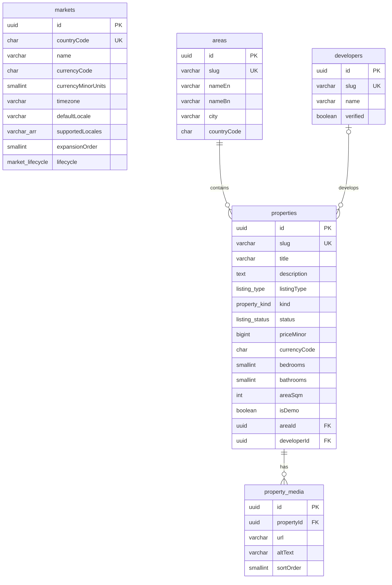

# Database ERD (currently implemented tables)

Covers the live schema verified in `DATABASE-VERIFICATION.md`. The planned tables are in
`DATABASE-MASTER-PLAN.md` and are not implemented yet.

`markets` has no foreign keys to the other tables yet. It is configuration that will link to
areas and properties when multi-market support is activated (Phase 9 of PLANNING.md).
